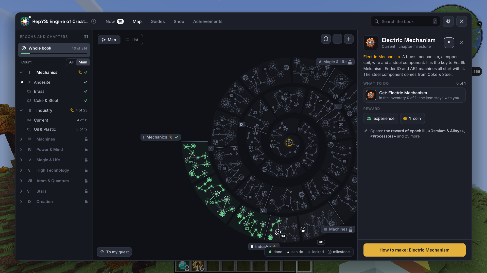

# RYSQuests

*Русская версия ниже: [по-русски](#по-русски).*



**A quest book for modpacks.** It guides the player through the pack step by step and shows the whole book as one map. The author builds it right in the game or as JSON files. It imports FTB Quests books together with player progress, so any modpack can switch to RYSQuests.

## Features

- a map of the whole book with automatic layout in four shapes
- a Now tab with the next step, a quest list and search
- guides with recipes, Ponder scenes and 3D structures
- a shop with currency, boss trophies and blocks for automation
- achievements, collections and titles
- shared team progress
- an in-game editor, the book as JSON files, progress migrations
- KubeJS and a Java API
- three themes: Slate, Glass and Vanilla Refined

The K key opens the book.

## Requirements

- Minecraft 1.21.1, NeoForge 21.1.x, client and server.
- No other mods required.
- Optional: JEI or RYSIndex, Ponder, Patchouli, KubeJS.
- Languages: English and Russian.

## Download and help

- Download: [CurseForge](https://www.curseforge.com/minecraft/mc-mods/rysquests).
- Help, ideas and questions: [Discord](https://discord.gg/Tqgy7acmyd).
- Bugs: [GitHub Issues](https://github.com/MityaKr/RYSQuests/issues).

## Documentation

- [docs/GUIDE.md](docs/GUIDE.md): everything the book can do, with JSON examples checked by the tests.
- [docs/for-pack-authors.md](docs/for-pack-authors.md): moving a modpack to RYSQuests, what each field shows.
- [docs/02-data-format.md](docs/02-data-format.md): every field of the book files.
- [examples/example_pack](examples/example_pack): a working book with chapters, guides, custom tabs, a shop and achievements.

The documents are in Russian.

## The RYS family

RYSQuests is part of the RYS family of mods: one style, shared themes and settings. Each mod works on its own, and together they complement each other.

- [RYSIndex](https://www.curseforge.com/minecraft/mc-mods/rysindex), a recipe viewer with crafting trees.
- [RYSMap](https://www.curseforge.com/minecraft/mc-mods/rysmap), a world map and minimap.
- [RYSClaims](https://www.curseforge.com/minecraft/mc-mods/rysclaims), chunk land claims.
- [RYSTeams](https://www.curseforge.com/minecraft/mc-mods/rysteams), player teams with roles and alliances.
- [RYSHelm](https://www.curseforge.com/minecraft/mc-mods/ryshelm), the Server window for admins.

## Building from source

You need Java 21. The build takes the family's shared code from the [RYSCore](https://github.com/MityaKr/RYSCore) repository, which must sit next to this one and be published to its local `repo/` folder first:

```
git clone https://github.com/MityaKr/RYSCore
git clone https://github.com/MityaKr/RYSQuests
cd RYSCore && ./gradlew publish
cd ../RYSQuests && ./gradlew build
```

The jar is in `build/libs`.

## License

The code is under [MPL-2.0](LICENSE). The graphics and the RYS name remain with the author, see [NOTICE.md](NOTICE.md). You can include the mod in any modpack without asking for permission.

Author: MityaYS, RepkaWorks.

---

## По-русски

**Книга квестов для сборок.** Ведёт игрока по сборке шаг за шагом и показывает всю книгу одной картой. Автор собирает её прямо в игре или файлами JSON. Есть импорт из FTB Quests вместе с прогрессом игроков, так что перейти на RYSQuests можно в любой сборке.

### Возможности

- карта всей книги с автоматической раскладкой в четырёх формах
- вкладка «Сейчас» со следующим шагом, список квестов и поиск
- гайды с рецептами, сценами Ponder и 3D-структурами
- магазин с валютой, трофеями боссов и блоками для автоматизации
- достижения, коллекции и титулы
- общий прогресс команды
- редактор в игре, книга в файлах JSON, миграции прогресса
- KubeJS и Java API
- три темы: Slate, Glass и Vanilla Refined

Книга открывается клавишей K.

### Требования

- Minecraft 1.21.1, NeoForge 21.1.x, клиент и сервер.
- Других модов не требует.
- По желанию: JEI или RYSIndex, Ponder, Patchouli, KubeJS.
- Языки: русский и английский.

### Скачать и спросить

- Скачать: [CurseForge](https://www.curseforge.com/minecraft/mc-mods/rysquests).
- Помощь, идеи и вопросы: [Discord](https://discord.gg/Tqgy7acmyd).
- Баги: [GitHub Issues](https://github.com/MityaKr/RYSQuests/issues).

### Документация

- [docs/GUIDE.md](docs/GUIDE.md): всё, что умеет книга, с примерами JSON, которые проверяют тесты.
- [docs/for-pack-authors.md](docs/for-pack-authors.md): как перевести сборку на RYSQuests, где видно каждое поле.
- [docs/02-data-format.md](docs/02-data-format.md): все поля файлов книги.
- [examples/example_pack](examples/example_pack): рабочая книга с главами, гайдами, своими вкладками, магазином и достижениями.

### Семья RYS

RYSQuests входит в семью модов RYS: один стиль, общие темы и настройки. Каждый мод работает сам по себе, а вместе они дополняют друг друга.

- [RYSIndex](https://www.curseforge.com/minecraft/mc-mods/rysindex), справочник рецептов с деревом крафта.
- [RYSMap](https://www.curseforge.com/minecraft/mc-mods/rysmap), карта мира и миникарта.
- [RYSClaims](https://www.curseforge.com/minecraft/mc-mods/rysclaims), приват земли по чанкам.
- [RYSTeams](https://www.curseforge.com/minecraft/mc-mods/rysteams), команды игроков с ролями и союзами.
- [RYSHelm](https://www.curseforge.com/minecraft/mc-mods/ryshelm), окно «Сервер» для администраторов.

### Сборка из исходников

Нужна Java 21. Общий код семьи сборка берёт из репозитория [RYSCore](https://github.com/MityaKr/RYSCore): он должен лежать рядом с этим и сначала выложиться в свою папку `repo/` командой `gradlew publish` (команды выше). Готовый jar лежит в `build/libs`.

### Лицензия

Код под [MPL-2.0](LICENSE), графика и имя RYS остаются за автором, подробности в [NOTICE.md](NOTICE.md). Мод можно включать в любую сборку без отдельного разрешения.

Автор: MityaYS, RepkaWorks.
